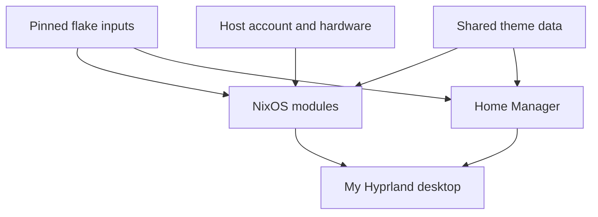

# NixOS + Hyprland

I run my laptop on NixOS with Hyprland and Home Manager. This is my personal
desktop configuration: compact spacing, thin borders, shared themes, and the
applications I use for school, photos, gaming, and my homelab.

I keep the system, desktop, local patches, and setup logic here so I can rebuild
my environment from pinned inputs. I'm sharing what I use and how it works; the
defaults reflect my hardware and preferences.

## My desktop

| Area | What I use |
| --- | --- |
| Session | Hyprland, UWSM, SDDM, and hyprlock |
| Desktop controls | Waybar, Rofi, SwayNotificationCenter, and floating terminal controls |
| Appearance | Monochrome and Catppuccin Latte, with shared colors, fonts, and spacing |
| Workspaces | Ten desktops shared across my screens, with sliding workspace wallpapers |
| Everyday apps | LibreWolf, Dolphin, Joplin, ONLYOFFICE, darktable, and themed Vesktop |
| Gaming | Steam, Lutris, Modrinth, and Moonlight |
| Android | On-demand Waydroid, Aurora Store, and shared photo folders |
| Laptop policies | Automatic power profiles, battery conservation, and memory-pressure safeguards |

My [desktop guide](docs/desktop.md) covers the controls and applications. I
explain the theme adapters in [theme/README.md](theme/README.md), the wallpaper
renderer in [workspace wallpapers](docs/wallpapers.md), and my Android setup in
[Waydroid](docs/waydroid.md).

## How I organize it



| Path | What I keep there |
| --- | --- |
| `hosts/nixos/` | My Lenovo's account, disks, monitors, and host-specific settings |
| `modules/nixos/` | Shared OS, hardware support, and desktop services |
| `home/jeffreyc/` | My applications, shortcuts, and Home Manager configuration |
| `theme/` | Theme selection, semantic colors, typography, and geometry |
| `dotfiles/` | Hyprland Lua, wallpaper helpers, screenshots, and boot-screen sources |
| `packages/` | Local packages and focused upstream patches |
| `bootstrap/`, `scripts/`, `tests/` | Setup templates, system helpers, and regression checks |

## Rebuilding my laptop

My checked-in `nixos` host is a **Lenovo IdeaPad 5 2-in-1 14AKP10**. I validate
and apply it from this checkout with:

```bash
nix flake check --show-trace
nix build .#nixosConfigurations.nixos.config.system.build.toplevel --no-link
sudo nixos-rebuild switch --flake .#nixos
```

**`.#nixos` contains my account and disk identifiers. I use it only on this
laptop.** My [maintenance guide](docs/maintenance.md) covers updates,
activation, and recovery. My wallpapers, application data, account logins, and
private keys stay outside Git.

## Setting up another machine

I keep a bootstrap command for reproducing the shared setup on an existing
**x86-64 NixOS installation**. It preserves that installation's account, disks,
encryption, bootloader, and graphics settings rather than copying my Lenovo's.
It does not partition disks or install NixOS from scratch.

I start with a preview:

```bash
nix --extra-experimental-features 'nix-command flakes' run github:AldogPlays/nixos-config#bootstrap
```

I document the prerequisites and `--apply` workflow in the [installation
guide](docs/installation.md). My package set includes proprietary software;
Cisco Packet Tracer requires a separate installer download. The pinned base is
NixOS 26.05. My checks evaluate Intel/UEFI, AMD/BIOS, and NVIDIA hosts, but I
haven't completed a fresh VM or spare-PC bootstrap activation trial.

## Everyday shortcuts

I use Meta/Super for the Windows or logo key.

| Action | Shortcut |
| --- | --- |
| Terminal / browser / files | Meta+T / Meta+F / Meta+E |
| App launcher | Meta+A |
| Theme selector | Meta+Ctrl+T |
| Desktops 1–10 | Meta+1–9, Meta+0 |
| Notifications | Meta+N |
| Wi-Fi / Bluetooth / audio | Meta+Shift+N / B / A |
| System monitor | Meta+Esc |
| Screenshot | Print or Meta+Shift+S |
| Lock screen | Meta+L |

I currently use Monochrome, with grayscale wallpaper copies that leave my
original images untouched. I can switch to Catppuccin Latte through the theme
selector; it builds and applies the selected preset through the normal rebuild
workflow.

## My notes

- **Setup and daily use:** [Installation](docs/installation.md), [desktop](docs/desktop.md), and [Waydroid](docs/waydroid.md).
- **Appearance:** [Shared themes](theme/README.md) and [workspace wallpapers](docs/wallpapers.md).
- **Maintenance:** [Updates and recovery](docs/maintenance.md), [homelab VPN](docs/homelab-vpn.md), and [security](SECURITY.md).
- **Design and history:** [System context](docs/system-context.md) and my [initial migration audit](docs/audit.md).
- **Repository:** [Contributing](CONTRIBUTING.md), [agent instructions](AGENTS.md), and [public-source checks](docs/public-release.md).

My related [Homelab](https://github.com/AldogPlays/Homelab) repository documents
the services and infrastructure I connect to from this desktop.

## License

I license my original source and documentation under the [MIT License](LICENSE).
Adapted code, palette data, and packaged applications retain their own licenses;
I list those in [third-party notices](THIRD_PARTY_NOTICES.md).
